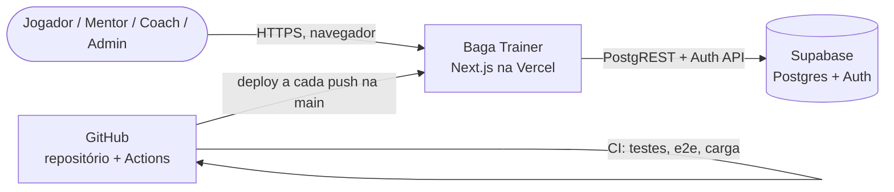
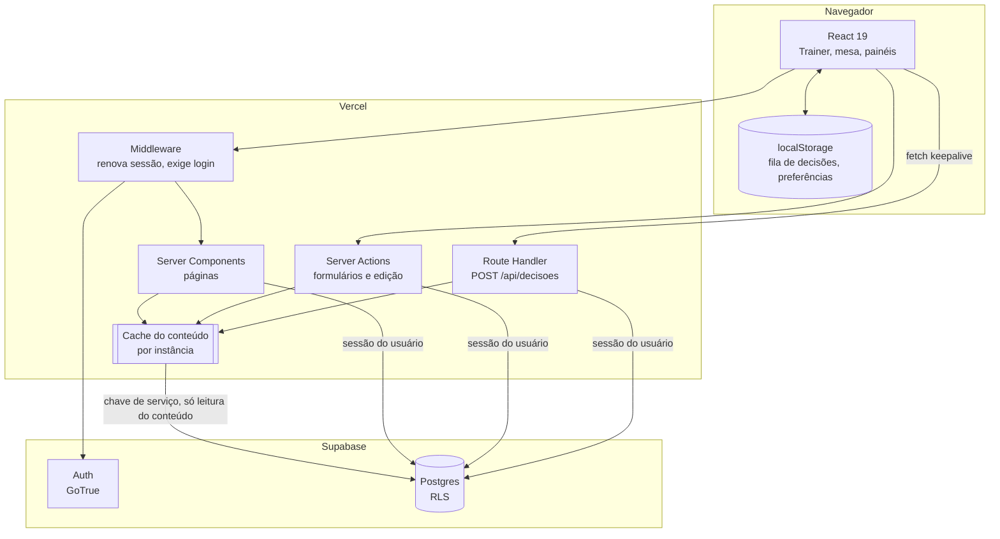

# Arquitetura do Baga Trainer

> Modelo arc42, versão enxuta. Última revisão: novembro de 2026.

## 1. Introdução e objetivos

O Baga Trainer é uma ferramenta web de treino de poker (MTT) no estilo GTO Wizard, com as estratégias
exploitativas do time Baga Pool. Jogadores treinam *drills* (exercícios) gerados a partir dos ranges e das
regras do time; mentores e coaches acompanham o desempenho por jogador e por pool.

### Requisitos principais

| # | Requisito |
| --- | --- |
| R1 | Treinar drills pré-flop e pós-flop com correção imediata (certo, errado ou "meio certo") |
| R2 | Uma biblioteca única de estratégias para todo o time, atualizada a cada aula |
| R3 | Leak finder: desempenho por drill, situação, posição, stack, proporção e tipo de board |
| R4 | Plano do mês por jogador (stats do HUD → focos → metas por drill) e warmup de 15 minutos |
| R5 | Permissões por papel e por pool, garantidas no banco |
| R6 | Funcionar bem no celular |

### Metas de qualidade

| Prioridade | Meta | Como é atendida |
| --- | --- | --- |
| 1 | **Correção**: a resposta certa é a do time, sempre | Regras em funções puras testadas; correção refeita no servidor |
| 2 | **Segurança dos dados** | RLS no Postgres; chave de serviço só no servidor; senhas com hash (Supabase Auth) |
| 3 | **Desempenho com centenas de jogadores** | Cache do conteúdo em memória; gravação em lote; teste de carga no CI |
| 4 | **Evolução rápida** | Conteúdo como código (cargas no repositório), CI com testes em 3 níveis |

### Partes interessadas

| Papel | Interesse |
| --- | --- |
| Jogador | Treinar e ver o próprio desempenho e o da pool |
| Mentor | Acompanhar as pools que mentora, cadastrar jogadores da própria pool |
| Coach / Admin de drills | Criar e ajustar estratégias, drills e standards |
| Admin (Jorge) | Cadastro do time, papéis, pools; dono do produto |

## 2. Restrições

- **Hospedagem**: Vercel (Next.js serverless) + Supabase (Postgres gerenciado, Auth). Planos gratuitos ou
  de entrada; sem servidores próprios.
- **Equipe**: desenvolvimento assistido por IA, com revisão do dono do produto; o CI é a principal rede de
  segurança.
- **Idioma**: interface 100% em português do Brasil.
- **Sem dados pessoais sensíveis** além de nome, nick, e-mail (opcional) e histórico de treino.

## 3. Contexto (C4 — nível 1)



Sistemas externos: **Supabase** (dados e login), **Vercel** (hospedagem e CDN), **GitHub** (código, CI e
capturas do teste de ponta a ponta na branch `ci-capturas`). Não há integração direta com sites de poker;
os stats do Hand2Note entram digitados no Plano do mês.

## 4. Estratégia da solução

| Problema | Abordagem | ADR |
| --- | --- | --- |
| Muitas regras de poker que mudam a cada aula | Regras em TypeScript puro (`src/lib/poker`), testadas com `node:test` | [0003](adr/0003-motor-de-regras-em-codigo.md) |
| Conteúdo (ranges, drills) atualizado com frequência | Cargas JSON versionadas no repositório, importadas sozinhas no primeiro acesso de cada versão | [0002](adr/0002-cargas-versionadas-no-repositorio.md) |
| Permissões confiáveis | Row Level Security no Postgres, além das checagens na interface | [0001](adr/0001-supabase-com-rls.md) |
| Jogador não pode "se dar" acerto | Navegador manda só a escolha; o servidor recalcula a resposta | [0004](adr/0004-correcao-no-servidor.md) |
| Leitura pesada do conteúdo a cada página | Cache em memória com conferência de versão | [0005](adr/0005-cache-do-conteudo-em-memoria.md) |
| Uma escrita no banco por clique | Fila no navegador e gravação em lote | [0006](adr/0006-decisoes-em-lote.md) |

## 5. Visão de blocos

### 5.1 Containers (C4 — nível 2)



### 5.2 Componentes do código

```
src/
  app/                    rotas (App Router)
    (app)/                área logada: layout com Nav, sincronização das cargas
      drills/             lista, treino, criar/editar drill (+ actions.ts)
      desempenho/         leak finder, visão das pools mentoradas
      plano/              plano do mês e metas por drill
      aquecimento/        warmup de 15 minutos com os drills do plano
      estrategias/        editor de ranges (gestão de conteúdo)
      legenda/            cores por ação
      admin/              jogadores, pools, standards
    api/decisoes/         gravação em lote das decisões
    login/, trocar-senha/ autenticação por nick
  components/             componentes React (Trainer, PokerTable, RangeGrid...)
  lib/
    poker/                domínio puro, sem I/O (ver tabela abaixo)
    content.ts            cache do conteúdo (servidor)
    content-cache.ts      lógica do cache (pura, testada)
    decision-queue.ts     fila de decisões do navegador (pura, testada)
    record-attempts.ts    correção e gravação de um lote (servidor)
    cargas.ts, cargas-sync.ts   registro e importação das cargas
    data.ts               acesso a dados (perfil, tentativas, planos...)
    supabase/             clientes: navegador, servidor (sessão), admin (chave de serviço)
cargas/                   conteúdo do time em JSON (estratégias, drills, legenda)
supabase/migrations/      esquema, RLS, funções
scripts/                  e2e, teste de carga, teste do banco
```

Módulos do domínio (`src/lib/poker`):

| Módulo | Responsabilidade |
| --- | --- |
| `cards`, `hands`, `range` | Cartas, 169 mãos, combos, ranges e notação em texto (`22+, A2s+`) |
| `texture` | Classes de carta (A, H = T–K, M = 9–6, L = 5–2), naipes, board pareado |
| `strategy`, `importer` | Tipo `Strategy`, validação e importação de cargas |
| `drill` | Sorteio de mãos e boards, sequência de decisões, correção (`gradeSubmission`) |
| `table` | Mesa: fichas, pote, stacks mostrados por street |
| `cbet`, `vs-cbet`, `bb-vs-barrel`, `bw-bb-pos`, `threebet-pot`, `cbet-turn` | Motor de regras pós-flop (game plan MES de cada aula) |
| `leaks`, `pool-report`, `plan` | Leak finder, relatório de pool, plano do mês |
| `sections`, `permissions`, `legend` | Seções da tela de drills, papéis, cores |

## 6. Visão de execução (fluxos principais)

### 6.1 Abrir um drill

```mermaid
sequenceDiagram
  participant N as Navegador
  participant M as Middleware
  participant P as Página /drills/[id]/treinar
  participant C as Cache do conteúdo
  participant DB as Supabase
  N->>M: GET /drills/cbet-turn-ip/treinar
  M->>DB: auth.getUser() (renova cookie)
  M->>P: segue
  P->>DB: perfil do usuário (RLS)
  P->>C: drill + estratégias + legenda
  alt em memória e conferido há < 30s
    C-->>P: devolve na hora
  else passou a janela
    C->>DB: settings: content_version, cargas_version
    C-->>P: mesma versão → memória; mudou → recarrega
  end
  P-->>N: HTML + só as estratégias que o drill usa
  Note over N: o sorteio das mãos roda no navegador
```

### 6.2 Treinar e gravar decisões

```mermaid
sequenceDiagram
  participant T as Trainer (navegador)
  participant F as Fila (localStorage)
  participant A as POST /api/decisoes
  participant DB as Postgres
  T->>T: jogador responde; correção imediata na tela
  T->>F: mão concluída entra na fila
  alt 5 decisões, 10s, fim de sessão ou saída da página
    F->>A: lote (fetch keepalive)
    A->>A: valida (zod), confere sessão, recorrige cada decisão
    A->>DB: 1 INSERT com todas as linhas (RLS: user_id = auth.uid())
    A-->>F: ok → remove do lote
  else sem conexão
    F-->>T: aviso "Vamos tentar de novo"; fila mantida
  end
```

### 6.3 Publicar conteúdo novo (carga)

```mermaid
sequenceDiagram
  participant Dev as Desenvolvimento
  participant GH as GitHub (main)
  participant V as Vercel
  participant L as Layout (primeiro acesso)
  participant DB as Postgres
  Dev->>GH: push (carga JSON + regras + testes)
  GH->>GH: CI: testes, banco, e2e, carga
  GH->>V: deploy automático
  L->>DB: settings.cargas_version == hash das cargas?
  alt versão nova
    L->>DB: upsert estratégias e drills, legenda; grava cargas_version
    L->>L: invalida o cache desta instância
    Note over DB: outras instâncias percebem em até 30s
  end
```

## 7. Implantação

| Ambiente | Onde | Observações |
| --- | --- | --- |
| Produção | Vercel (projeto `trainer-bagapool`) + Supabase (região São Paulo) | Deploy automático a cada push na `main` |
| CI | GitHub Actions, `ubuntu-latest` | Supabase local (CLI + Docker), `next start`, Playwright |
| Local | `npm run dev` + projeto Supabase de desenvolvimento ou o local do CLI | `.env.local` |

Variáveis de ambiente: ver [operacao.md](operacao.md#variáveis-de-ambiente).

## 8. Conceitos transversais

### Segurança

- **Autenticação**: Supabase Auth com e-mail interno por nick; senhas com hash (bcrypt) no Supabase.
  Cadastro aberto desligado: só admin e mentores (para a própria pool) criam acessos, com senha provisória
  e troca obrigatória no primeiro acesso.
- **Autorização**: em duas camadas. A interface esconde o que o papel não pode usar
  (`lib/poker/permissions.ts`) e o banco recusa de qualquer forma (RLS, ver [dados.md](dados.md)).
- **Chave de serviço** (`SUPABASE_SERVICE_ROLE_KEY`): só no servidor (`import "server-only"`). Usada para
  cadastrar membros, importar cargas e ler o conteúdo compartilhado no cache, sempre depois de
  `requireProfile`/`requireAdmin`.
- **Integridade do treino**: o navegador não envia se acertou; o servidor recalcula.

### Desempenho e escalabilidade

- **Cache do conteúdo** (ADR 0005): estratégias (1.100+), drills e legenda ficam em memória por instância;
  conferência de versão a cada 30s com uma consulta mínima; idade máxima de 10 min.
- **Envio mínimo ao navegador**: a página de treino manda só as estratégias que o drill usa.
- **Gravação em lote** (ADR 0006): 5 decisões por requisição, um `INSERT` só.
- **Índices**: `attempts (user_id, created_at desc)` e `attempts (drill_id)` atendem o Desempenho.

Resultado do teste de carga no CI (100 jogadores simultâneos, 60s, tempo entre ações de 0,3 a 0,9s, cerca
de 10× mais rápido que um jogador real), num runner de 2 vCPUs com Next e Supabase na mesma máquina:

| Rota | p50 | p95 |
| --- | ---: | ---: |
| Gravar lote de 5 decisões | 326 ms | 570 ms |
| Abrir treino | 859 ms | 1178 ms |
| Lista de drills | 889 ms | 1232 ms |
| Desempenho | 1187 ms | 1514 ms |

5.303 requisições, 0 erros, 13.935 decisões gravadas (218/s). Na Vercel cada função escala de forma
independente; o limite passa a ser o Postgres do Supabase (conexões e plano).

### Tratamento de erros

- Ações do servidor devolvem `ActionResult` (`{ ok: true } | { ok: false, error }`) com mensagens em
  português; a interface mostra o texto.
- Importação de cargas não derruba a página: erros vão para o log e a versão não é gravada (tenta de novo).
- A fila de decisões descarta só a decisão inválida (drill arquivado, estratégia removida) e segue.

### Experiência no celular

- Mesa em pé abaixo de 640px; atalhos de teclado configuráveis no desktop; até 4 mesas simultâneas.

## 9. Decisões de arquitetura

Ver a pasta [adr/](adr/). Resumo:

| ADR | Decisão | Status |
| --- | --- | --- |
| [0001](adr/0001-supabase-com-rls.md) | Supabase com RLS como backend | Aceita |
| [0002](adr/0002-cargas-versionadas-no-repositorio.md) | Conteúdo do time como cargas JSON no repositório | Aceita |
| [0003](adr/0003-motor-de-regras-em-codigo.md) | Regras pós-flop em código TypeScript puro | Aceita |
| [0004](adr/0004-correcao-no-servidor.md) | Correção refeita no servidor | Aceita |
| [0005](adr/0005-cache-do-conteudo-em-memoria.md) | Cache do conteúdo em memória com versão | Aceita |
| [0006](adr/0006-decisoes-em-lote.md) | Decisões gravadas em lote | Aceita |
| [0007](adr/0007-teste-de-carga-no-ci.md) | Teste de carga com 100 jogadores no CI | Aceita |

## 10. Qualidade

Ver [testes.md](testes.md). Em resumo: testes unitários do domínio (`node:test`), testes das permissões no
Postgres, teste de ponta a ponta no navegador (Playwright) com capturas de tela, e teste de carga, todos
a cada push.

## 11. Riscos e débitos técnicos

| Risco / débito | Impacto | Mitigação ou próximo passo |
| --- | --- | --- |
| Middleware e página chamam `auth.getUser()` (2 idas ao Auth por página) | Latência e cota do Auth com muitos usuários | Avaliar `getClaims()` (validação local do JWT) no middleware |
| Desempenho lê todas as tentativas do período e agrega no servidor | Fica pesado com meses de histórico | Agregação no banco (view materializada ou RPC por dimensão) |
| Cache por instância: edições feitas direto no painel do Supabase levam até 10 min | Conteúdo desatualizado por alguns minutos | Usar o app ou gravar `content_version` em `settings` após a edição |
| `localStorage` da fila pode ser limpo pelo navegador | Perda de decisões ainda não enviadas | Envio a cada 5 decisões e a cada 10s reduz a janela |
| Regras das aulas interpretadas a partir de PDFs/legendas | Resposta diferente da intenção do professor | Testes com os exemplos da aula; revisão do time após cada drill novo |
| Tabela `attempts` cresce sem limite | Custo e consultas mais lentas | Particionar por mês ou arquivar após 12 meses |
| Migrações rodadas à mão no painel | Esquecer uma migração | Supabase CLI com `db push` no deploy |

## 12. Glossário

| Termo | Significado |
| --- | --- |
| Drill | Exercício: sequência de decisões sorteadas de uma ou mais estratégias |
| Estratégia | Spot com range (pré-flop) ou regra (pós-flop) e as ações possíveis |
| Carga | Arquivo JSON em `cargas/` com estratégias, drills e cores novas |
| MES | Game plan exploitativo do time usado nas regras pós-flop (sigla das aulas) |
| RFI, MLR, BW, PKO | Raise first in; max late reg; blind war; progressive knockout |
| Cbet, probe, barrel | Aposta de continuação do agressor; aposta de quem não agrediu; aposta na street seguinte |
| Runout | Carta do turn/river e o que ela muda no board (A ou H, brick, dobra, 3F, 4S...) |
| Pool | Grupo de jogadores do time, com mentor e cor própria |
| RLS | Row Level Security: regras de acesso por linha no Postgres |
